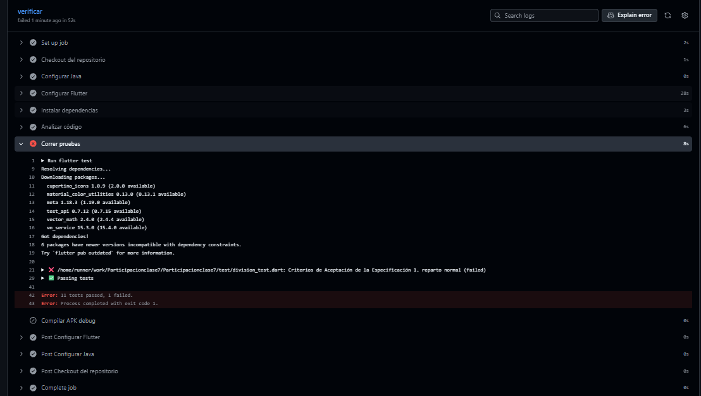
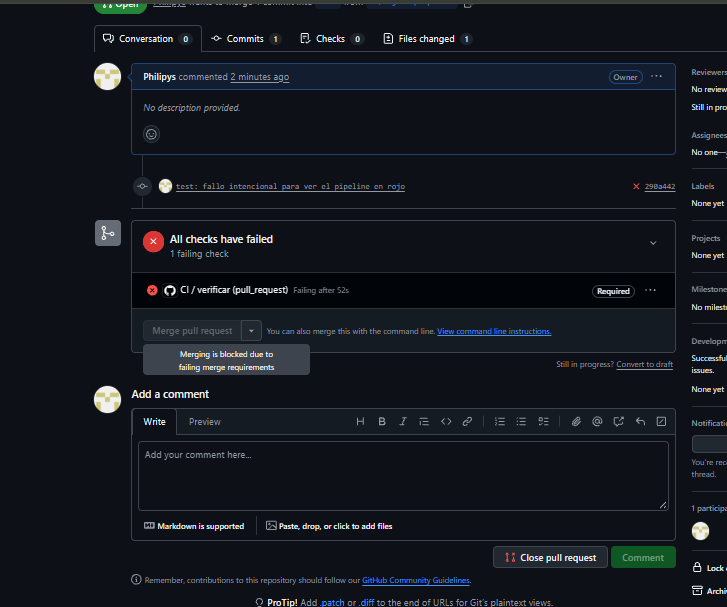
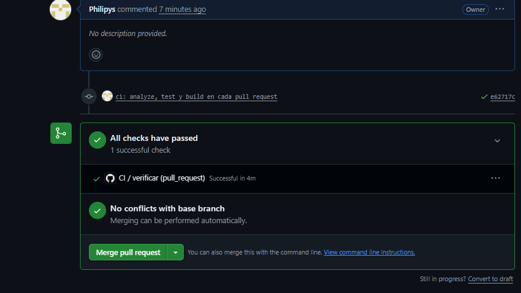
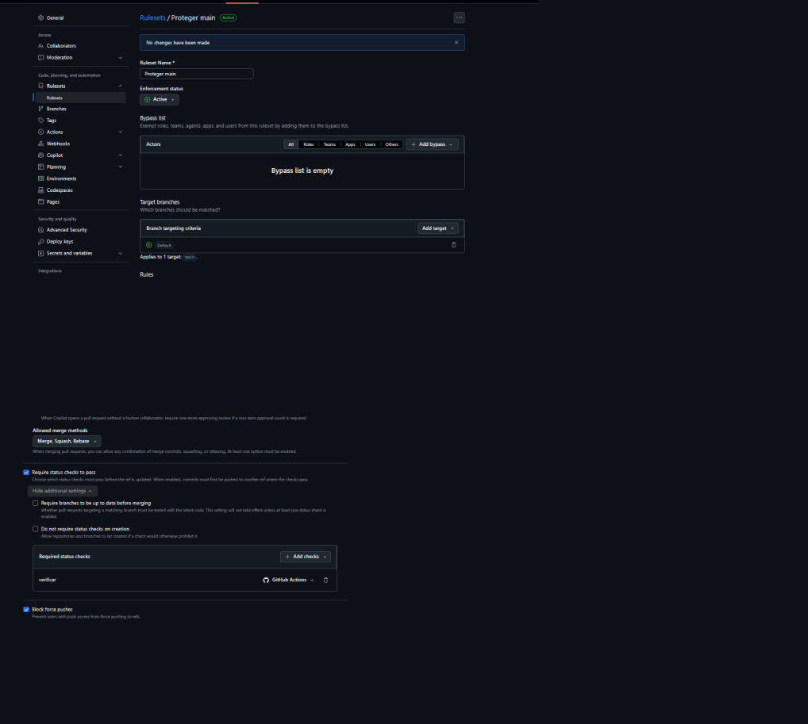
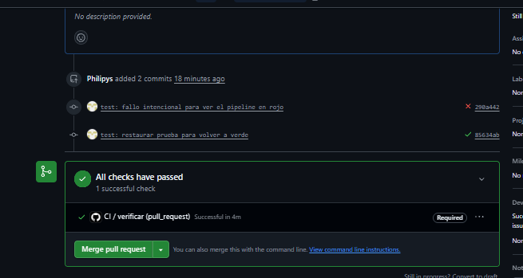
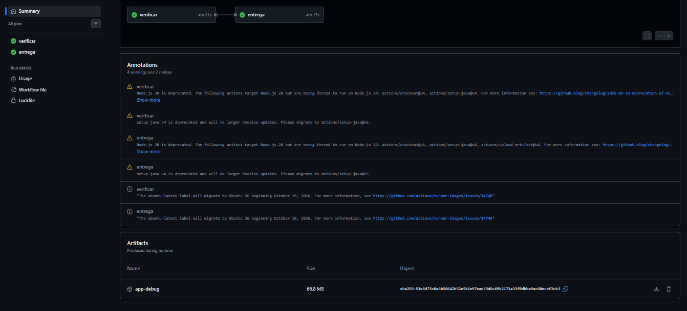

# Respuestas — Deber 4: De TDD a CI/CD

**Estudiante:** Felipe  
**Materia:** Programación Asistida de Aplicaciones · USFQ  
**Profesor:** Jose David Vega Sánchez  

---

### 1. Pega tu `ci.yml` y explica, en una línea cada uno, qué hace `analyze`, `test` y `build`.

```yaml
name: CI

on:
  push:
    branches: [ main ]
  pull_request:
    branches: [ main ]

jobs:
  verificar:
    runs-on: ubuntu-latest

    steps:
      - name: Checkout del repositorio
        uses: actions/checkout@v4

      - name: Configurar Java
        uses: actions/setup-java@v4
        with:
          distribution: 'temurin'
          java-version: '17'

      - name: Configurar Flutter
        uses: subosito/flutter-action@v2
        with:
          channel: 'stable'

      - name: Instalar dependencias
        run: flutter pub get

      - name: Analizar código
        run: flutter analyze

      - name: Correr pruebas
        run: flutter test

      - name: Compilar APK debug
        run: flutter build apk --debug

  entrega:
    needs: verificar
    if: github.event_name == 'push' && github.ref == 'refs/heads/main'
    runs-on: ubuntu-latest

    steps:
      - name: Checkout del repositorio
        uses: actions/checkout@v4

      - name: Configurar Java
        uses: actions/setup-java@v4
        with:
          distribution: 'temurin'
          java-version: '17'

      - name: Configurar Flutter
        uses: subosito/flutter-action@v2
        with:
          channel: 'stable'

      - name: Instalar dependencias
        run: flutter pub get

      - name: Compilar APK debug
        run: flutter build apk --debug

      - name: Subir APK como artefacto
        uses: actions/upload-artifact@v4
        with:
          name: app-debug
          path: build/app/outputs/flutter-apk/app-debug.apk
```

* **`analyze` (`flutter analyze`):** Examina estáticamente el código fuente sin ejecutarlo para detectar errores de sintaxis, tipos y violaciones a las reglas del linter.
* **`test` (`flutter test`):** Ejecuta de forma automatizada la suite completa de pruebas unitarias y de widgets para verificar que la lógica de cálculo y la UI cumplan las especificaciones.
* **`build` (`flutter build apk --debug`):** Compila el código Dart junto con las dependencias nativas de Android generando el archivo ejecutable binario (`app-debug.apk`) para asegurar que la app ensamble correctamente.

---

### 2. Adjunta la captura del ✗ de la Parte 3. ¿Qué línea del log te dijo exactamente qué falló?



* **Línea del log que indicó el fallo exacto:**  
  La línea 21 del paso `Correr pruebas` en el log de Actions:
  ```text
  ✗ /home/runner/work/Participacionclase7/Participacionclase7/test/division_test.dart: Criterios de Aceptación de la Especificación 1. reparto normal (failed)
  ```
  Donde el reporte de fallo mostró la discrepancia:
  ```text
  Expected: a numeric value within <0.001> of <27.0>
    Actual: <27.5>
     Which: differs by <0.5>
  ```

---

### 3. ¿Qué diferencia hay entre *continuous integration*, *continuous delivery* y *continuous deployment*? ¿Cuál implementaste y por qué?

* **Continuous Integration (CI):** Práctica en la que el equipo fusiona código frecuentemente en una rama compartida y cada integración se valida automáticamente mediante compilación estática, análisis y pruebas unitarias/de integración para detectar fallos tempranamente.
* **Continuous Delivery (CD - Entrega Continua):** Extensión de CI donde, tras validar las pruebas, el software se compila y empaqueta automáticamente en un artefacto instalable o ejecutable listo para producción/pruebas, el cual queda disponible para ser desplegado en cualquier momento mediante una decisión o aprobación humana.
* **Continuous Deployment (CD - Despliegue Continuo):** Automatización completa de extremo a extremo donde cada cambio que supera las pruebas se despliega directa e inmediatamente al entorno de producción para los usuarios finales, sin requerir intervención manual alguna.

* **¿Cuál implementaste y por qué?:**  
  Implementamos **Continuous Integration (CI)** y **Continuous Delivery (CD)**.  
  CI se implementó en el job `verificar` (corre en cada PR validando con `analyze`, `test` y `build`).  
  Continuous Delivery se implementó en el job `entrega`, que genera y publica el instalador `app-debug.apk` como artefacto tras unirse a `main`. No es Continuous Deployment porque no publicamos automáticamente a la Google Play Store ni a usuarios finales; un APK de depuración sin firma de producción requiere revisión y control humano antes de ser distribuido.

---

### 4. Adjunta la captura del *merge* bloqueado (Parte 3). ¿Qué problema evita que `main` quede roto?



* **Problema que evita:**  
  Evita que código defectuoso, con errores de compilación o regresiones en las reglas de negocio, se integre a la rama principal (`main`). Al bloquear el botón de merge ante cualquier falla en los checks requeridos, se garantiza que `main` sea siempre una rama estable, funcional y lista para desplegarse, impidiendo que el trabajo de otros desarrolladores se rompa por cambios no verificados.

---

### 5. ¿Qué sugirió el agente en la Parte 5? ¿Cuál aceptaste y cuál rechazaste, y por qué?

* **Sugerencias de seguridad y fragilidad señaladas por el agente:**
  1. *Fijar versiones inmutables por SHA:* Reemplazar tags flotantes como `@v4` o `@v2` por hashes SHA inmutables de los commits para mitigar riesgos en la cadena de suministro si una acción de terceros es comprometida.
  2. *Principio de menor privilegio:* Declarar explícitamente `permissions: contents: read` para que el token de GitHub Actions no tenga permisos de escritura innecesarios.
  3. *Reutilización de artefacto en entrega:* En lugar de volver a compilar el APK en `entrega`, hacer que `verificar` lo suba y `entrega` lo descargue, ahorrando más de 4 minutos de cómputo en runners.
  4. *Incorporación de acciones de terceros no verificadas:* Usar acciones comunitarias externas para "acelerar la caché de Gradle/Flutter" o subir automáticamente el APK a servicios de hosting en la nube no oficiales.

* **¿Cuál aceptaste y cuál rechazaste, y por qué?:**
  * **Acepté:** La recomendación de restringir permisos del token (`permissions`) y reutilizar artefactos entre jobs para optimizar tiempos y seguridad, ya que utilizan funciones nativas y documentadas de GitHub Actions.
  * **Rechacé:** La inclusión de acciones externas de terceros no verificadas para caché o distribución externa. Introducir dependencias de repositorios comunitarios desconocidos añade vectores de ataque a la cadena de suministro (*supply-chain attack*) y fragilidad si esos repositorios son eliminados o modificados sin control.

---

### 6. ¿Qué garantiza realmente un CI verde y qué errores pueden quedar sin detectar? Da un ejemplo de un error que pasaría en verde.

* **Qué garantiza realmente:**  
  Un CI verde únicamente garantiza que el código **compila**, que cumple las reglas sintácticas del **linter** y que satisface **exclusivamente las pruebas que fueron escritas**.
* **Qué errores pueden quedar sin detectar:**  
  - Errores en flujos no cubiertos por pruebas (casos borde o escenarios no contemplados en la suite).
  - Problemas de usabilidad, experiencia de usuario (UX) o defectos visuales (elementos superpuestos, texto ilegible en pantallas reales).
  - Errores de rendimiento o consumo excesivo de memoria en hardware real.
  - Fallos de configuración o incompatibilidad con versiones específicas del sistema operativo móvil (Android SDK / hardware específico).
* **Ejemplo de un error que pasaría en verde:**  
  Si un desarrollador cambia el color de un botón o del texto del resultado a blanco sobre fondo blanco, o altera los márgenes haciendo que la pantalla se vuelva incómoda de usar, `flutter analyze`, `flutter test` y `flutter build` pasarán en verde con éxito, pero la aplicación será inutilizable para un usuario humano.

---

### 7. ¿Qué detectó el pipeline que tú no habías visto?

El pipeline en GitHub Actions alertó sobre detalles del entorno limpio de ejecución que no eran visibles en el entorno local:
1. **Advertencias de deprecación en las GitHub Actions:** En la sección de *Annotations* del run, GitHub Actions notificó que las acciones oficiales (`actions/checkout@v4`, `actions/setup-java@v4`) utilizan Node.js 20, el cual entra en fase de deprecación y migrará a Node.js 24.
2. **Migración de la imagen base de Ubuntu:** Notificó que la etiqueta `ubuntu-latest` pronto migrará a Ubuntu 26, lo cual podría provocar cambios sutiles en librerías del sistema base.
3. **Independencia absoluta de entornos entre jobs:** Al ejecutar `verificar` y `entrega`, evidenció que cada job corre en una máquina virtual limpia y aislada de corta duración, por lo que ningún archivo generado en un job existe en el siguiente a menos que se publique explícitamente a través de artefactos.

---

## Galería de Evidencias

| Evidencia | Descripción |
|---|---|
|  | **Parte 1:** Pull Request inicial con el job `verificar` en verde (✓). |
|  | **Parte 2:** Configuración de protección de rama `main` con check obligatorio `verificar`. |
|  | **Parte 3:** Fallo en rojo (✗) del pipeline y línea del log del error. |
|  | **Parte 3:** Botón de merge deshabilitado y bloqueado por la regla de protección. |
|  | **Parte 3:** Pull Request recuperado en verde (✓) y merge habilitado. |
|  | **Parte 4:** Sección *Artifacts* en Actions con `app-debug` generado y entregado. |
